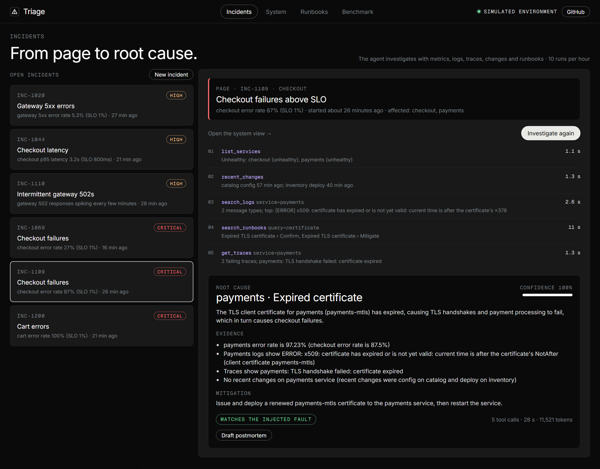
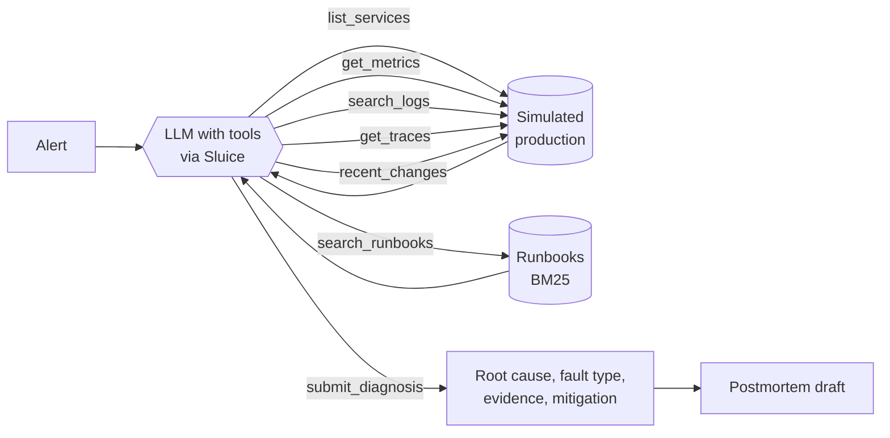
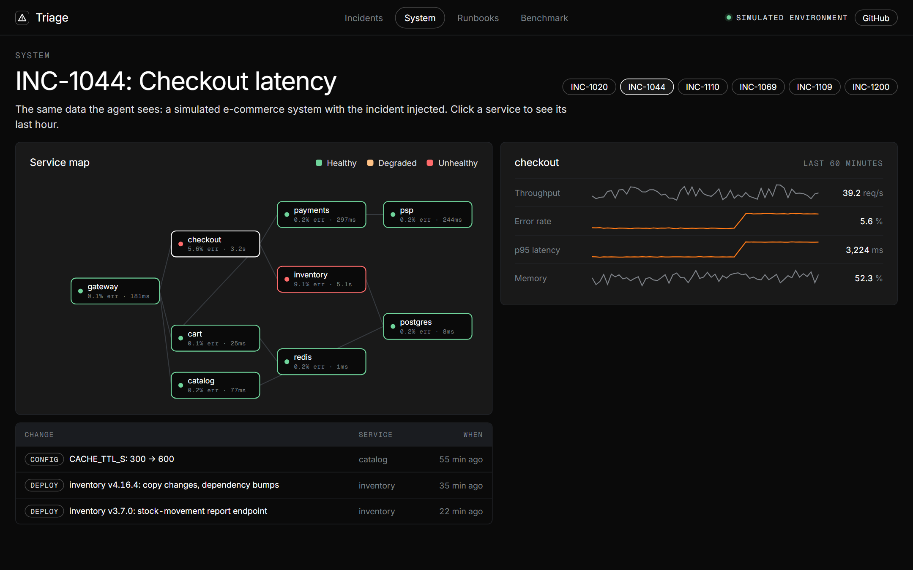
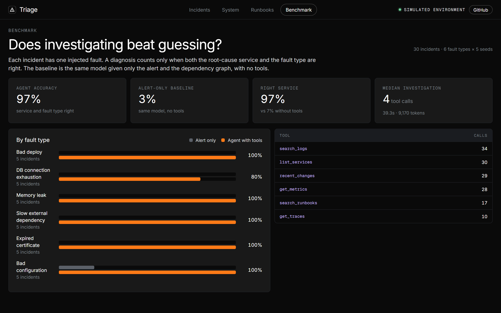
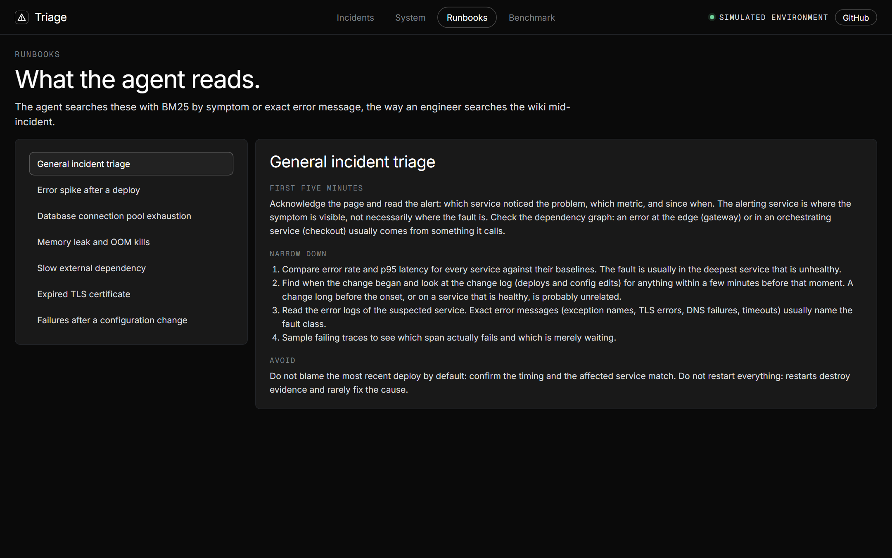

<p align="center">
  
</p>

<p align="center">
  <a href="https://triage-virid-theta.vercel.app"></a>
</p>

<p align="center">
  
  
  
  
  
  
</p>

# Triage

**Tool-Using Incident Response Agent with Evidence-Backed Diagnoses.** When a production alert fires, Triage investigates the way an on-call engineer does: it checks service health, reads metrics and error logs, follows failing traces, lines up the change history against the moment things broke, consults the runbooks, and then names the service where the fault originates, the fault type, the evidence and the mitigation. It drafts the postmortem too.

**Live demo: https://triage-virid-theta.vercel.app** · pick an incident, press Investigate, and watch each tool call as it happens.

<p align="center">
  <a href="https://triage-virid-theta.vercel.app"></a>
</p>

## Results

30 incidents (6 fault types × 5 seeds), scored strictly: a diagnosis counts only when **both** the root-cause service and the fault type match the injected fault. The baseline is the same model with the same prompt, given only the alert and the dependency graph, and no tools. Reproduce with [`bench/eval_incidents.py`](bench/eval_incidents.py); every run is in [`bench/results/`](bench/results).

| | Correct diagnosis | Right service |
|---|---|---|
| **Triage (tools + verification gate)** | **96.7%** (29 / 30) | 96.7% |
| Triage without the verification gate | 93.3% (28 / 30) | 93.3% |
| Alert-only baseline (same model, no tools) | 3.3% | 6.7% |

| Fault | Triage | Alert only |
|---|---|---|
| Bad deploy | 5 / 5 | 0 / 5 |
| DB connection exhaustion | 4 / 5 | 0 / 5 |
| Memory leak | 5 / 5 | 0 / 5 |
| Slow external dependency | 5 / 5 | 0 / 5 |
| Expired certificate | 5 / 5 | 0 / 5 |
| Bad configuration | 5 / 5 | 1 / 5 |

- **Typical investigation:** 4 tool calls and 9,170 tokens (median). The benchmark's 39 s median per incident also includes the baseline call and free-tier rate-limit waits; live investigations in the demo take roughly 15 to 30 seconds.
- **The one miss** was not a wrong answer: a Gemini model rejected the request with a provider error mid-investigation. Sluice now falls back on that error too.
- **Without the gate**, both misses were the slow-dependency case: the agent named `payments`, the service calling the slow provider, instead of the provider itself. Making it read the logs and the change history before concluding fixed that.
- Mean confidence on correct diagnoses: 0.98.

## The environment

Triage runs against a deterministic simulation of an e-commerce system, clearly labelled as such in the console: an edge gateway, checkout, payments, inventory, cart and catalog services, Postgres, Redis and an external payment provider. Each incident injects one of six faults and produces an hour of per-minute metrics, log templates with counts, sample traces and the change history.

| Fault | What the evidence looks like |
|---|---|
| Bad deploy | New exception on one service right after its release; callers' errors rise |
| DB connection exhaustion | Pool timeouts, Postgres at max connections, 40-second queries from a new endpoint |
| Memory leak | Sawtooth memory, OOM kills and restarts, 502s at each restart |
| Slow external dependency | Read timeouts to the payment provider, no internal change, normal CPU |
| Expired certificate | x509 errors from one minute to the next, no deploy at that moment |
| Bad configuration | DNS failure naming a typo'd host right after a config edit |

What makes it an investigation rather than a lookup: **the alert names the symptom, not the cause** (an expired payments certificate pages as "checkout failures"; database exhaustion pages as "checkout latency"), and every incident carries **red herrings**: unrelated deploys and config edits on healthy services, and background warnings. The same `(fault, seed)` always produces the same incident, so the benchmark is reproducible.

## How it works



- **Forced tool use.** The model must call a tool on every turn (`tool_choice: required`), so it investigates instead of guessing, and it can only finish through `submit_diagnosis`, whose schema enforces a service, a fault type, evidence, a mitigation and a confidence.
- **Verification gate.** A diagnosis is sent back until the agent has read the error logs and the change history, and every evidence item must come from a tool result. It was added after a live run concluded in three calls and cited a change that never happened; its effect is measured below.
- **Compact tool outputs.** Metrics come back as baseline, now, peak, when it changed and a 5-minute sparkline; logs are grouped by template with counts and first-seen times. Each result is a few hundred tokens, because the whole history is resent on every step and free tiers allow a few thousand tokens per minute.
- **Runbook retrieval** is BM25 over runbook sections: runbooks are dense with exact error strings, which lexical search matches well, and it needs no embedding quota.
- **Through Sluice.** Every call goes through [Sluice](https://github.com/rohithprem18/sluice), which picks the fastest healthy model and falls back mid-investigation. Building Triage surfaced two provider quirks that Sluice now handles: Groq rejecting a turn where the model wrote its tool call as text (`tool_use_failed`), and Gemini 3 rejecting tool calls made by another model because they lack its thought signature. Sluice routes tool requests only to models with structured tool calling, and translates tool history between providers. Triage also recovers tool calls a model writes as JSON text.

## Console

| | |
|---|---|
|  |  |
| **Incidents:** the live investigation, the diagnosis with evidence and confidence, the ground truth and a postmortem draft | **System:** the service map coloured by health, per-service metrics and the change log the agent sees |
|  |  |
| **Benchmark:** agent versus alert-only baseline, by fault type | **Runbooks:** what the agent searches |

## Run locally

```bash
git clone https://github.com/rohithprem18/triage.git && cd triage
python -m venv .venv && source .venv/bin/activate     # Windows: .venv\Scripts\activate
pip install -r requirements-dev.txt
cp .env.example .env                                  # TRIAGE_LLM_API_KEY: a Sluice key, or any OpenAI-compatible endpoint with tools
set -a && . ./.env && set +a
uvicorn triage.app:app --port 8000
cd web && npm ci && npm run dev                       # console on http://localhost:5177
```

Run the benchmark: `python bench/eval_incidents.py` (resumable; `--summarize` rebuilds the summary).

## Deploy (free)

The API is one Vercel Python function and the console is static. `npx vercel link`, add `TRIAGE_LLM_API_KEY` (optionally Upstash Redis for shared rate limits) with `npx vercel env add`, then `npx vercel deploy --prod`.

## Project layout

```
triage/
├── triage/
│   ├── simulator.py   # the simulated system: topology, six faults, metrics, logs, traces, changes
│   ├── tools.py       # tool implementations + OpenAI function schemas, compact outputs
│   ├── agent.py       # the investigation loop, text tool-call recovery, postmortem, alert-only baseline
│   ├── runbooks.py    # BM25 over runbook sections
│   ├── runbooks/      # seven runbooks
│   ├── llm.py         # OpenAI-compatible client with tool calling (Sluice by default)
│   └── app.py         # FastAPI: incidents (opaque codes), streaming investigations, runbooks, benchmark
├── bench/             # 30-incident evaluation + every run
├── web/               # React + Vite console
└── tests/             # 24 tests: simulator invariants, tools, scripted agent runs, the gate, API
```

## Limitations

- The environment is simulated. Real incidents are messier: several things break at once, telemetry has gaps, and runbooks are out of date. The simulator is a controlled testbed for the investigation loop, not a claim about production accuracy.
- Six fault types and 30 incidents is a small benchmark; the interval around each number is wide.
- Triage recommends mitigations; it never executes them.

## Contributing

Contributions of every size are welcome, from fixing a typo to building a feature, and no experience is required. Issues labelled [**good first issue**](https://github.com/rohithprem18/triage/issues?q=is%3Aissue+is%3Aopen+label%3A%22good+first+issue%22) are picked to be a friendly start.

<p>
  <a href="https://github.com/rohithprem18/triage/actions/workflows/ci.yml"></a>
  <a href="https://github.com/rohithprem18/.github/blob/main/CONTRIBUTING.md"></a>
  <a href="https://github.com/rohithprem18/triage/issues?q=is%3Aissue+is%3Aopen+label%3A%22good+first+issue%22"></a>
  <a href="#contributors"></a>
</p>

1. **Pick an issue** (or open one with your idea) and comment that you're working on it.
2. **Fork** the repository and create a branch: `git checkout -b fix/short-description`.
3. **Make your change** and run the same checks as CI (see [`.github/workflows/ci.yml`](.github/workflows/ci.yml)).
4. **Open a pull request.** When every check passes, it is **merged automatically** and you appear under [Contributors](#contributors).

Changes to workflows, dependencies or deployment config wait for a maintainer review. See the [contributing guide](https://github.com/rohithprem18/.github/blob/main/CONTRIBUTING.md) and the [Code of Conduct](https://github.com/rohithprem18/.github/blob/main/CODE_OF_CONDUCT.md).

## Contributors

Thanks to everyone who has helped build this project!

<!-- CONTRIBUTORS:START -->
<table>
  <tbody>
    <tr>
      <td align="center" valign="top" width="14%"><a href="https://github.com/rohithprem18"><br /><sub><b>rohithprem18</b></sub></a><br /><sub>12 commits</sub></td>
    </tr>
  </tbody>
</table>
<p><sub>1 contributor so far. This list updates automatically after every merged pull request.</sub></p>
<!-- CONTRIBUTORS:END -->

## License

MIT
